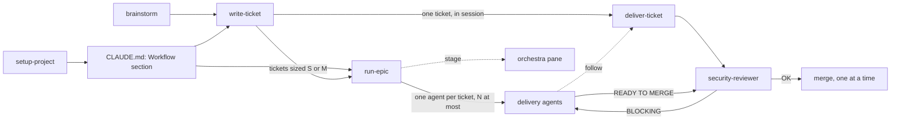

# ticket-flow — a working method for Claude Code

ticket-flow sets up a ticket-driven way of working in any project and gives
Claude Code the skills to follow it:

- **tickets small enough for one agent**: a size gate splits anything bigger into an epic;
- **one ticket delivered end to end** in the session: worktree, checks, docs, review, merge, boxes ticked;
- **epics or ticket lists run in waves** by background agents, with a cap on how many run at once;
- **a security review before every merge**, by a dedicated read-only agent;
- **clean documentation**, updated in the same commit as the code, with Mermaid and SVG diagrams;
- **project brainstorming** grounded in the code, the tickets and the history;
- **a live view** of the orchestrator and of each agent (the optional `orchestra` mod).

It works with GitHub issues, GitHub Projects boards and Linear.

> Up to date as of 2026-10-14 (`ticket-flow` 0.6.0, `orchestra` 0.5.0), tested with Claude Code 2.1.295.

## Install

In a Claude Code session:

```
/plugin install ticket-flow --marketplace Xavier-Cliquennois/claude-ticket-flow
/plugin install orchestra --marketplace Xavier-Cliquennois/claude-ticket-flow
```

Answer `y` to add the marketplace, then pick a scope (user scope is the usual
choice). `orchestra` is optional: it uses the Claude Code mods API, which is
still in early access. `ticket-flow` uses the same API for its update band
only: without it, the skills, agent and hooks work as before, and you update
with `/plugin` as usual.

Then, once per project:

```
/ticket-flow:setup-project
```

## How it fits together



| Piece | Kind | What it does |
|---|---|---|
| `setup-project` | skill | Checks git, the GitHub remote, the tracker and its labels, offers to create what is missing, writes the `## Workflow` section of `CLAUDE.md`. |
| `write-ticket` | skill | Ticket and epic templates with a "done when" checklist and who created it (the person to ask); always asks who takes the ticket; model, size, type and security labels; **splits tickets too big for one agent**; puts tickets on the board. |
| `deliver-ticket` | skill | Delivers one ticket end to end in the session: worktree, build, verify, docs, security review, merge, boxes, board. Also the procedure `run-epic`'s agents follow. |
| `run-epic` | skill | Orchestrates an epic or a list of tickets in the background: waves, capped parallel agents, security gate, serialized merges, checkboxes, board moves, revealed tickets. |
| `security-reviewer` | agent | Read-only review of a diff; verdict BLOCKING / OK WITH RESERVATIONS / OK with verified findings. |
| `project-docs` | skill | Documentation standard (layout, naming, Mermaid, SVG) and a docs audit mode. |
| `brainstorm` | skill | Facilitated session about the project: ground, diverge, converge, turn picks into tickets. |
| doc reminder | hook | Before every `git commit`, reminds Claude to check the docs still describe the code. |
| update band | built-in mod | A row above the prompt when a newer `ticket-flow` is published, with an **Update** button that installs it and reloads plugins in the open session; also offers `setup-project` when the project's `## Workflow` section is from an older template. |
| `orchestra` | mod | `/orchestra` pane: current stage, each subagent with its duration, last tool and context fill; the shell commands they run, with the live tail of background ones; a one-line status file for the status line. |

## Documentation

- [Concepts](docs/concepts.md): the method and why each rule exists.
- [Getting started](docs/guides/getting-started.md): install, set up a project, first ticket.
- [Running an epic](docs/guides/running-an-epic.md): what `run-epic` does, step by step.
- [Skills and agent reference](docs/reference/skills.md)
- [The `## Workflow` section of CLAUDE.md](docs/reference/workflow-section.md)
- [Tickets, labels and the size gate](docs/reference/tickets-and-labels.md)
- [orchestra](docs/reference/orchestra.md)
- [FAQ and troubleshooting](docs/faq.md)

## Language

The skills talk to you in your language. Ticket, epic and agent-prompt
templates are written in French (the author's projects are); Claude translates
the headings when your project writes its tickets in another language.

## License

[MIT](LICENSE)
