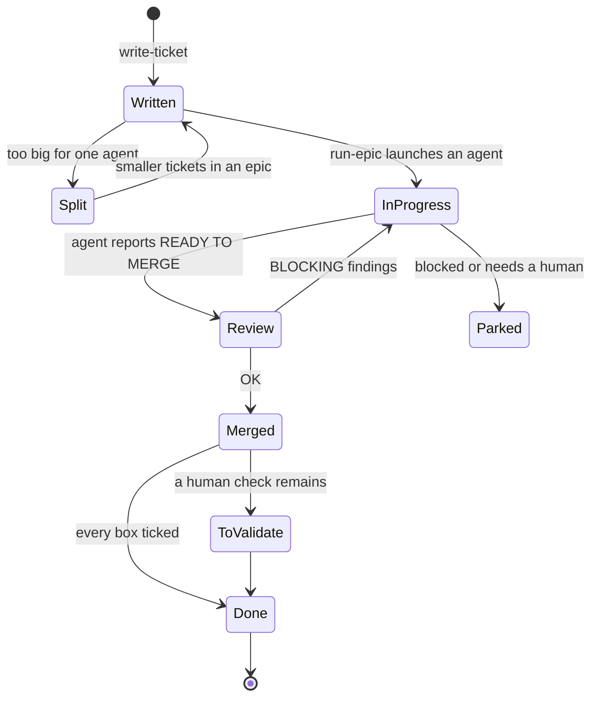

# Concepts

What the ticket-flow method is, and why each of its rules exists.

> Up to date as of 2026-10-09 (ticket-flow 0.1.0).

## The idea in one paragraph

Work is written down as tickets before it is done. Each ticket is small enough
for one Claude Code agent to deliver in one session, and says how anyone can
check it is done. Related tickets form an epic. One orchestrator session runs
an epic by handing each ticket to a background agent, a few at a time, and
merges their work one by one after a security review. Documentation moves with
the code. The project's `CLAUDE.md` holds the few settings that differ from one
project to another; everything else is the same everywhere.

## The rules, and why

### A ticket fits one agent

An agent whose context fills up gets slower, more expensive and less precise,
and Claude Code cannot make a subagent compact itself at a chosen threshold.
So the lever is upstream: the ticket. `write-ticket` scores every ticket
(files touched, responsibilities, checklist length, human time, open decisions,
exploration needed) and splits anything above size M. There is no size L.

Splitting follows a fixed order of preference: decide first, investigate
first, vertical slices, layers only when one is a prerequisite, then mechanical
bulk by area. See [tickets-and-labels.md](reference/tickets-and-labels.md).

### "Done when" is checkable by someone else

Each ticket ends with a checklist whose boxes another person (or agent) can
verify without asking the author: a command, a number, a browser recipe. No
"clean", no "works well". Boxes are ticked as work progresses, and a ticket is
closed only when every box is honestly ticked. A parent never closes just
because its children did.

After the merge, a ticket ends in one of three ways: every box ticked →
closed (by hand: GitHub only auto-closes on a merge into the default branch);
only a human check left (a visual, a measurement on a device) → open in
« to validate »; code or tests left → closed on what was delivered, with the
rest moved to a follow-up ticket. An open ticket with a merged PR therefore
always means « only a check is left ».

### A model label on every ticket

`model:opus` when the agent has to choose between options the ticket does not
settle (architecture, product, an intermittent bug, a large scope).
`model:sonnet` when the ticket says what to do and how to verify it.
`run-epic` launches each agent on the model its ticket names.

### Waves, and a cap on parallel agents

Agents running at once share one machine (dev servers, test runners, sometimes
the CI runner) and one repository. Two rules keep them out of each other's way:

- **a cap**: at most N agents run at once (N is set per project, 3 by default);
- **no file overlap within a wave**: two tickets touching the same files never
  run together. That is why every ticket lists the files it will probably touch.

A freed slot is refilled at once with the next unblocked ticket.

### The orchestrator never blocks on a question

A modal question asked while agents run stops the orchestrator from refilling
slots, sometimes for hours. The orchestrator writes its question as plain text,
parks what depends on it and keeps the other slots busy.

### The orchestrator keeps its own context small

It never reads diffs, logs or code. Agents send a fixed 25-line report; the
orchestrator decides from that.

### A security review gates every merge

Agents stop before their final merge and report READY TO MERGE. The
orchestrator runs the read-only `security-reviewer` agent on the branch.
HIGH or MEDIUM findings in scope block the merge and go back to the agent;
findings outside the ticket's scope become `sécurité` tickets and do not block.

### One merge at a time

Merges are serialized across the whole epic, so each one lands on a branch
that already contains the previous one.

### The browser check is never silently skipped

UI changes are checked in a browser: Chrome through the Claude in Chrome
extension first (the user's real session), Playwright if Chrome is closed or
fails two or three times, and otherwise the report says "browser test NOT DONE"
and why. It is never replaced by a `curl` without saying so.

### Docs move with the code

A change that makes a doc wrong updates it in the same commit. Docs describe
what is, not history. Flows are Mermaid diagrams kept in the text, spatial
things are hand-written SVG readable in light and dark themes. A hook reminds
Claude of this before every `git commit`.

### Per-project settings live in CLAUDE.md

The tracker, the board's status names, extra labels, verify commands, merge
flow and the parallel cap differ between projects. `setup-project` writes them
once into a `## Workflow` section of `CLAUDE.md`; every skill reads it. See
[workflow-section.md](reference/workflow-section.md).
