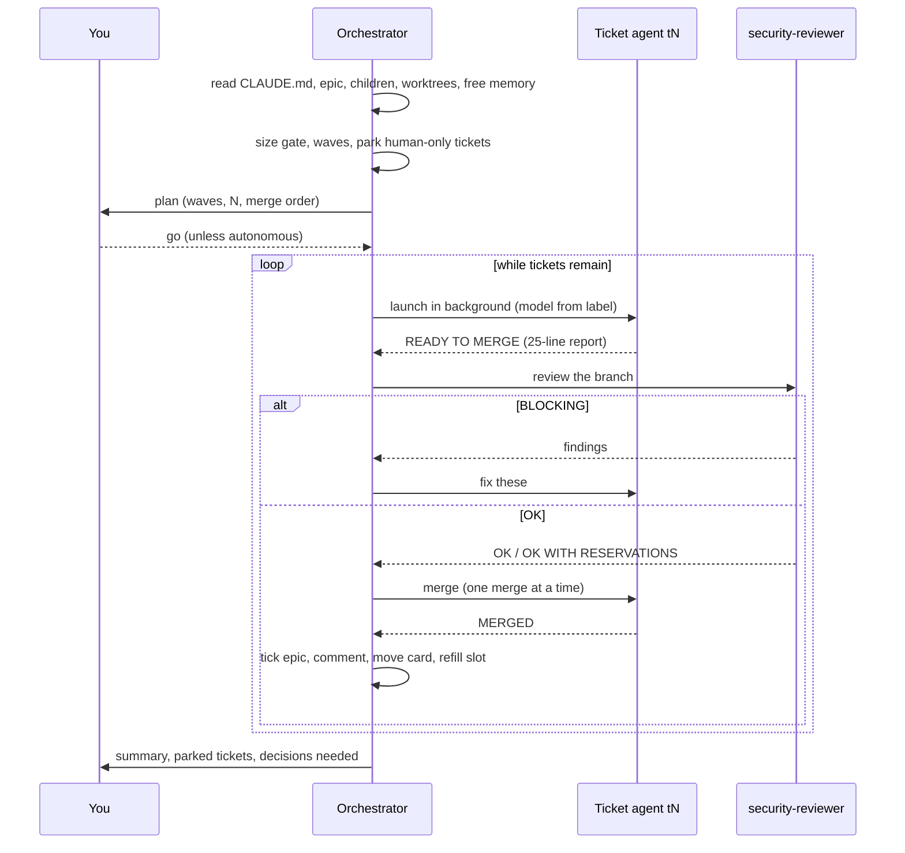

# Running an epic

What happens, step by step, when `run-epic` runs an epic, and what you see.

> Up to date as of 2026-10-09 (ticket-flow 0.2.0).

## Start it

```
/ticket-flow:run-epic #42
```

Name the epic: a GitHub issue (`#42`), a Linear issue (`ABC-42`), a Linear
project, or a plain list of tickets to run together (`/ticket-flow:run-epic
#12 #14 #17`, or one ticket to run in the background). A list runs exactly
like an epic, minus the epic steps: no epic line to tick, card to move or epic
to close; the closing summary is given in the terminal. With no name, the skill
lists candidates (open parents, issues labelled `epic`, Linear projects with
open issues) and asks; it never picks one itself. Say whether you want to give
a "go" before launch or an autonomous run.

## What it does



### 0. Read the frame

The orchestrator reads the `## Workflow` section of `CLAUDE.md` (tracker, max
parallel agents, merge flow, verify commands, resources that must never be used
twice at once, the project's own delivery skill if any), the epic and every
child with their state and blockers, existing worktrees (work in progress to
resume, never to recreate) and the machine's free memory.

### 1. Pre-flight

- Every open child must pass the size gate, carry a model label and a "done
  when" list. Missing pieces are fixed, oversized tickets are split, before
  anything is launched.
- Waves are built from blocked-by links, then from file overlap.
- Tickets that need a human eye (annotation, visual judgment, a product
  decision) are parked.
- The plan is shown: waves, N, parked tickets, merge order.

### 2. The loop

A ticket is launched when it is unblocked, its wave is reached, a slot is free
and no running agent touches its files. Each agent runs in the background,
named `t<N>`, on the model its label names, follows `deliver-ticket` in agent
mode (or the project's own delivery skill), with a fixed prompt: read first,
scope, files owned by sibling agents, worktree, dedicated ports or locks,
verify commands, long commands kept visible, browser protocol, docs rule,
context hygiene, stop before the
final merge, and the report format.

| Agent reports | Orchestrator does |
|---|---|
| READY TO MERGE | runs `security-reviewer`; BLOCKING → sends the findings back; OK → "merge", once the previous merge is done |
| MERGED | checks the ticket's real state: closed → ✅; to validate → 🧪; code left → follow-up ticket, original closed; comments the epic, refills the slot |
| BLOCKED / NOT DELIVERED | comments the reason, parks the ticket, refills the slot; relaunches once at most |
| revealed tickets | creates them with `write-ticket` (sub-issue if the epic needs them) |

Two BLOCKING rounds in a row park the ticket and tell you.

### 3. The board

With a GitHub Projects board or Linear statuses, cards move as work does:
launched → in progress; parked → blocked; merged with a human check left → to
validate; closed → done. The epic stays in progress until it closes.

The epic body follows along: in the "Vagues" section, the table's status
column and the Mermaid graph's nodes show each ticket's state:

| State | Emoji | Node | When |
|---|---|---|---|
| in progress | 🟡 | yellow | launched, not merged yet |
| to validate | 🧪 | blue | merged, only a human check left (ticket open) |
| done | ✅ | green | ticket closed |
| blocked | ⛔ | red | parked or blocked |

A wave is ✅ once all its tickets are closed, 🧪 when all are merged and one
still waits for its check. A 🧪 ticket unblocks the tickets that wait for it:
its code is merged. When you have done the check, say so (« j'ai testé #380,
c'est bon »): `deliver-ticket` ticks the box, closes the ticket, and the node
turns ✅. A resumed run re-reads every state from the tracker first.

A merged ticket with code or tests left is not kept open: the agent closes it
and lists each leftover point (what, why not now, what it would take); the
orchestrator creates the follow-up ticket with the remaining boxes, attaches it
to the epic, carries over the original's open blocked-by links, comments the
original, and adds the follow-up to the epic's table and graph, like any ticket
revealed during the run (in a wave not started yet when it fits, otherwise a
new row). Only a manual check keeps a merged ticket open (🧪).

An epic written before this section existed gets it added in pre-flight.

### 4. Closing

The orchestrator comments the epic with what was delivered (with merge
commits), what is parked and why, the revealed tickets, and the epic's own
"done when" box by box. It closes the epic only when those boxes are honestly
ticked, then tells you what needs you.

## What you see while it runs

- The `/orchestra` pane (optional mod): stage line, one row per agent with
  status, duration, context fill (green, yellow from 30 %, red from 40 %),
  last tool and compactions.
- A third status-line row with the stage and the number of active agents, if
  you added the widget (see [orchestra.md](../reference/orchestra.md)).
- `/tasks` in Claude Code lists background agents; Enter opens a transcript.

## Tips

- Keep N low on a laptop that also runs the CI or heavy test suites; 2 is a
  good start.
- Name exclusive resources in `CLAUDE.md` (a benchmark, a lock script, a
  database): the orchestrator gives each to one agent at a time.
- If an agent's context goes red often, the tickets are too big: tighten the
  size gate rather than fighting compaction.
