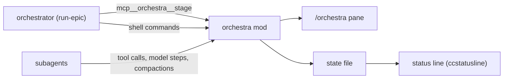

# orchestra

What the optional `orchestra` mod shows, how the orchestrator feeds it, and its
limits.

> Up to date as of 2026-10-13 (orchestra 0.4.1). Uses the Claude Code mods
> API, which is in early access and may change between releases.

## What it shows

**The `/orchestra` pane** opens by itself when a subagent starts or a stage is
published, and on demand with `/orchestra`:

```
╭──────────────────────────────────────────────────────────────────╮
│ ORCHESTRA                12:44 · 2 actifs · 8 finis · 1 en échec │
│ ▶ vague 2/3 · t486 fusionné · t487 t488 en cours 3 min           │
│ Σ 12 agents · 582 appels · 41 M tok                              │
│ ⏵ orchestrateur · Wait for CI on PR #436 · 6 min · fond          │
│   $ gh pr checks 436 --watch                                     │
│   │ e2e     pending                                              │
╰──────────────────────────────────────────────────────────────────╯

EN COURS · 2 ───────────────────────────────────────────────────────
● t488 XAV-488 bouton relancer le paiement                   4 min
  ctx ██░░░░░░░░ 18 % · Bash
  ⏵ Type-check the app · 18 s
    $ npx tsc --noEmit -p .
● t487 XAV-487 export CSV des commandes                     12 min
  ctx ███░░░░░░░ 34 % · Edit
  ⏵ Run export tests · 1 min · fond
    $ npm run test -- src/export/orders.test.ts
    │ ✓ escapes quotes in names (4 ms)
    │ ● streams 10 000 rows…

TERMINÉS · 9 ───────────────────────────────────────────────────────
✓ sec-486 Security revi…   1 min ·   7 appels ·   75 k tok   5 %
✗ t484    XAV-484 w… failed  41 min · 135 appels ·   16 M tok  44 %
✓ t486    XAV-486 volume…  27 min ·  90 appels · 4647 k tok  19 %
… 6 de plus
```

- **Header frame**: clock, running / ended / failed counts, the current stage
  and how long ago it was published, and the run's totals (`Σ`): agents, tool
  calls and tokens, running agents included, live.
- **EN COURS**: one two-line card per running agent: name, task and duration;
  a **context gauge** (green under 30 %, yellow from 30 %, red from 40 %),
  compactions, and the last tool, or, while the agent runs a command, that
  command and how long it has run. A card keeps its height whether a command
  runs or not, so the pane does not jump as commands follow one another.
- **COMMANDES**: a foldable block, folded by default. Folded, it is one line:
  the newest running command, who runs it and since when (`depuis 12 s`, `+N`
  when others run too), else the last one ended (`fini il y a 3 s`). A click
  on its title, or `c` while the pane has the focus, unfolds the latest 3
  commands, running first, each with its command line; a running background
  command also shows the last 3 lines of its output, refreshed every 5
  seconds.
- **TERMINÉS**: one aligned line per ended agent, newest first: ✓ or ✗, name,
  task, then its effort: duration, tool calls and tokens, then its context
  fill (coloured from 30 %); `failed` or `killed` spelled out. Figures are
  integers: tokens past 10 000 in `k`, past 10 000 000 in `M`. On a narrow
  pane the line never wraps: the context fill goes first, then the effort
  shortens (`27 min ·  90 app ·   4647 k`), then only the duration is left.
  What does not fit ends in `… N de plus`.

**A status-line file**: `~/.claude/state/orchestra/<session id>.txt` holds one
line (`▶ <stage> · N agents actifs`), empty when idle. Point your status line at
it (below).

## How it works



- **Stage**: the mod registers a tool, `mcp__orchestra__stage({ text })`.
  `run-epic` calls it at each state change; any session can.
- **Agents**: every 5 seconds the mod lists the session's agents
  (`$.agent.list()`); it records each subagent's last tool (`tool.call`), its
  context fill from the input tokens of its latest model request
  (`turn.step`), and its compactions (`session.compact`).
- **Effort**: the mod counts each subagent's tool calls (one per `tool.call`
  it makes) and its tokens (every `turn.step` of its loop: input, cache reads,
  cache writes and output, summed), from its own events alone. What comes
  before the first tick lists the agent is kept aside and added once it is
  listed. That waiting table holds 200 loops at most, the oldest dropped
  first, since a loop the list never shows (a workflow's) would stay in it
  forever. An ended agent keeps its figures.
- **Commands**: the mod watches every `Bash` call (`tool.call`). A background
  launch answers with its task id and the file its output goes to; the mod
  reads the end of that file on each tick. The command ends with its
  `<task-notification>` row (`session.append`), a `TaskStop`, or, for a
  subagent's command that dies with it, when the subagent ends.
- **Safety**: the stage text and agent descriptions come from the model; C0/C1
  control characters (escape sequences included) are stripped before they are
  stored, drawn or written to the state file. The same goes for commands and
  their output, after a carriage return keeps only what it left on screen
  (progress bars). A failure in the command tracking hands the call on
  untouched: it never makes a command fail.

## Status line

The mod does not draw in the engine's own status area: that area shows plain
text behind a warning glyph. Use the state file instead. With
[ccstatusline](https://github.com/sirmalloc/ccstatusline), add a custom-command
widget (needs `jq`):

```json
{
  "id": "orchestra",
  "type": "custom-command",
  "color": "yellow",
  "commandPath": "f=\"$HOME/.claude/state/orchestra/$(jq -r .session_id).txt\"; [ -s \"$f\" ] && cat \"$f\" || true",
  "timeout": 1000
}
```

Put it alone on a line: the line disappears when the file is empty. Add
`"refreshInterval": 30` to the `statusLine` block of `~/.claude/settings.json`
so a clock widget (`date +%H:%M`) keeps moving.

Any other status-line script can do the same: read `session_id` from the JSON
on stdin and print the file.

## Limits

- The context percentage divides by the session model's window. A subagent on
  a model with a different window shows a wrong percentage.
- The pane needs a terminal at least 110-144 columns wide to open unasked; in
  a narrow terminal, open it with `/orchestra`.
- Only a background command shows its output while it runs: a foreground one
  shows its command and duration. A command that redirects its output to its
  own file (`script.sh > run.log`) leaves the task output empty: have it write
  through `tee` to see it in the pane, with `pipefail` so a failure still
  fails (a pipe's exit code is otherwise `tee`'s, almost always 0):
  `set -o pipefail; script.sh 2>&1 | tee run.log`. A Python program writing
  into a pipe buffers its output: add `PYTHONUNBUFFERED=1` (or `python -u`) so
  lines show as they come.
- The effort figures are the pane's own count, not the ones the orchestrator
  writes in the epic's waves section (#18), which come from the completion
  notifications: the two can differ. The pane's tokens sum every request's
  whole input (cache reads included), so they can run much higher than a
  notification's total; and a mod reload while an agent has not been listed yet loses what was kept
  aside for it.
- Claude Code offers no way to compact a subagent at a chosen threshold; the
  colors are there to tell you a ticket was too big, not to act on it. See
  [concepts](../concepts.md#a-ticket-fits-one-agent).

## Development

```
claude plugin validate plugins/orchestra
cd plugins/orchestra && claude plugin test .
```

`plugins/orchestra/preview/index.html` is a simulated pane: open it in a
browser, pick a scenario and a terminal size. It ports the `ui.render` hook to
plain JavaScript over example data; change both together when the layout
changes.
