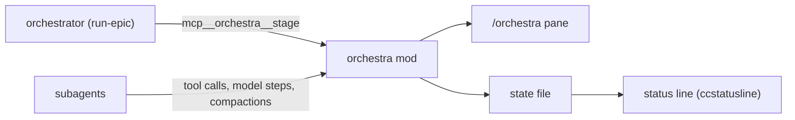

# orchestra

What the optional `orchestra` mod shows, how the orchestrator feeds it, and its
limits.

> Up to date as of 2026-10-09 (orchestra 0.1.0). Uses the Claude Code mods
> API, which is in early access and may change between releases.

## What it shows

**The `/orchestra` pane** opens by itself when a subagent starts or a stage is
published, and on demand with `/orchestra`:

```
10:34 · 2 agents actifs
Étape : vague 2/3 · t265 relu · t266 en cours (3 min)

● t266 · #266 export timeout
  12 min · ctx 34 % · Edit
● t267 · #267 retry button
  4 min · ctx 18 % · Bash
✓ t265 · #265 rename columns
  21 min · ctx 41 % · 1 compact. · completed
```

Per agent: name and task, status mark (● running, ✓ done, ✗ failed or
killed), duration, **context fill** (green under 30 %, yellow from 30 %, red
from 40 %), last tool while running, number of compactions.

**A status-line file**: `~/.claude/state/orchestra/<session id>.txt` holds one
line (`▶ <stage> · N agents actifs`), empty when idle. Point your status line at
it (below).

## How it works



- **Stage**: the mod registers a tool, `mcp__orchestra__stage({ text })`.
  `run-epic` calls it at each state change; any session can.
- **Agents**: every 5 seconds the mod lists the session's agents
  (`$.agent.list()`); it records each subagent's last tool (`tool.call`), its
  context fill from the input tokens of its latest model request
  (`turn.step`), and its compactions (`session.compact`).
- **Safety**: the stage text and agent descriptions come from the model; C0/C1
  control characters (escape sequences included) are stripped before they are
  stored, drawn or written to the state file.

## Status line

The mod does not draw in the engine's own status area: that area shows plain
text behind a warning glyph. Use the state file instead. With
[ccstatusline](https://github.com/sirmalloc/ccstatusline), add a custom-command
widget (needs `jq`):

```json
{
  "id": "orchestra",
  "type": "custom-command",
  "color": "yellow",
  "commandPath": "f=\"$HOME/.claude/state/orchestra/$(jq -r .session_id).txt\"; [ -s \"$f\" ] && cat \"$f\" || true",
  "timeout": 1000
}
```

Put it alone on a line: the line disappears when the file is empty. Add
`"refreshInterval": 30` to the `statusLine` block of `~/.claude/settings.json`
so a clock widget (`date +%H:%M`) keeps moving.

Any other status-line script can do the same: read `session_id` from the JSON
on stdin and print the file.

## Limits

- The context percentage divides by the session model's window. A subagent on
  a model with a different window shows a wrong percentage.
- The pane needs a terminal at least 110-144 columns wide to open unasked; in
  a narrow terminal, open it with `/orchestra`.
- Claude Code offers no way to compact a subagent at a chosen threshold; the
  colors are there to tell you a ticket was too big, not to act on it. See
  [concepts](../concepts.md#a-ticket-fits-one-agent).

## Development

```
claude plugin validate plugins/orchestra
cd plugins/orchestra && claude plugin test .
```
