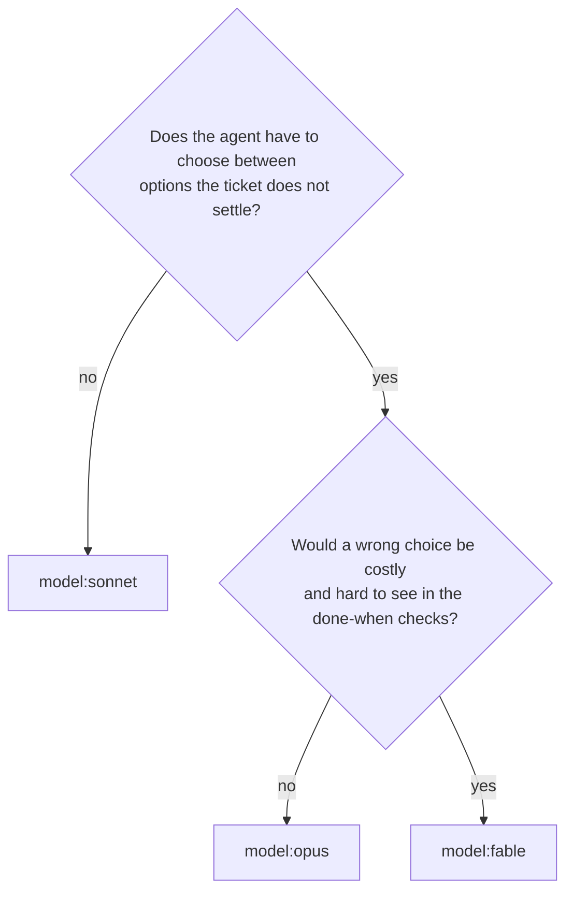

# Tickets, labels and the size gate

The ticket and epic templates, the standard labels, and how `write-ticket`
decides a ticket is too big and splits it.

> Up to date as of 2026-11-10 (ticket-flow 0.11.0).

## The size gate

A ticket must be deliverable by one agent in one session without its context
filling up. `write-ticket` scores every ticket on six signals:

| Signal | S | M | Too big → split |
|---|---|---|---|
| Files touched (excluding tests, i18n) | 1–3 | 4–8 | > 8 |
| Responsibilities (model, API, UI, migration, infra…) | 1 | 1–2 linked | ≥ 3 |
| "Done when" boxes | ≤ 3 | ≤ 6 | > 6 |
| Human time | < ½ day | ≤ 1 day | > 1 day |
| Open product / architecture decisions | 0 | 0 (decided in the ticket) | any undecided |
| Exploration needed before coding | none | one known area | "find out where/why" |

Any signal in the last column means split. There is no size L.

### How tickets are split, in order of preference

1. **Decide first**: undecided questions become a short `model:opus` / `effort:medium` ticket
   whose "done when" is the decision written into the epic.
2. **Investigate first**: "find out why" becomes its own ticket ending with a
   measurement or a diagnosis, not a fix.
3. **Vertical slices**: each piece delivers something testable end to end (one
   screen, its route, its data), rather than all the API then all the UI.
4. **By layer**, only when a layer is a prerequisite (a migration others need).
5. **Mechanical bulk** (a rename across 40 files, an i18n sweep): one
   `model:sonnet` ticket per area, files listed.

Each piece must pass the gate on its own; the pieces become sub-issues of an
epic.

## Labels

Created by `setup-project` (only after you agree), idempotently; your existing
labels are never renamed or recolored.

| Label | Meaning |
|---|---|
| `model:fable` | A choice the ticket does not settle where a mistake would be costly and hard to see: security-sensitive design, intermittent or concurrency bug, real-data migration, foundation of an epic, a ticket an opus agent already failed. Claude Fable 5.2, about twice Opus's price |
| `model:opus` | Ambiguous architecture or product decision, investigation, a scope the agent must decide itself |
| `model:sonnet` | The ticket says what to do and how to verify it |
| `effort:medium` | The agent runs at effort `medium`: most tickets |
| `effort:high` | Correctness over time: `sécurité`, data migration, concurrency, public API, critical path, a bug already missed once (the agent runs at `high`); the usual effort for `model:fable` |
| `challenger` | Before the merge, the `challenger` agent re-proves the "done when" boxes instead of trusting the delivery report. On any of: `model:opus` or `model:fable`, `effort:high`, `taille:M`, `sécurité`, a box proved by a judgment (diagnosis, bug fixed with no reproducing test, performance). Not on a `taille:S` / `model:sonnet` / `effort:medium` ticket whose boxes are all commands |
| `epic` | Parent of a wave of sub-issues (optional in Linear) |
| `taille:S` | Under half a human day, 1-3 files |
| `taille:M` | One human day at most, one responsibility |
| `sécurité` | Touches auth, another user's data, untrusted input or secrets |

Plus a type label (`bug`, `feature`, …; GitHub's defaults are reused) and any
project-specific taxonomy you already have, which is kept and documented.
Every ticket has exactly one model label and one effort label. In Linear,
the same labels live in a "Modèle IA" group (Fable / Opus / Sonnet), an
"Effort" group (Medium / High) and a "Taille" group. The next section says
how to choose them.

## Choosing the model, the effort and the challenger

`write-ticket` sets these labels when it writes the ticket; `run-epic`
checks them in its pre-flight and adds what is missing. Each agent then runs
exactly on what its ticket says.

### Model: two questions, in order

| Model | For | Examples |
|---|---|---|
| `model:sonnet` (Claude Sonnet 5.5) | The ticket says what to do and how to verify it | A well-located fix, a rename across an area, a11y/i18n/style fixes checked in the DOM |
| `model:opus` (Claude Opus 5.5) | The agent decides something the ticket leaves open | An architecture or product choice, an investigation, a scope to settle |
| `model:fable` (Claude Fable 5.2) | Same, and a mistake would be expensive and hard to catch | Security-sensitive design, an intermittent or concurrency bug, a migration of real data, the foundation other tickets of the epic build on, a ticket an opus agent already failed |

Fable is the most capable model and costs about twice Opus: it is kept for
the last row.

### Effort: two levels only

| Effort | The agent runs at | For |
|---|---|---|
| `effort:medium` | effort `medium` | Most tickets |
| `effort:high` | effort `high` | Correctness matters more than time: `sécurité` label, data migration, concurrency, a public API or contract, a ticket on the epic's critical path, a bug already missed once. The usual effort of a `model:fable` ticket (except a short decision ticket) |

The label is the exact effort passed to the agent, whatever the model: no
other level is ever used. Raise the effort before the model: `opus` at
`effort:high` is often enough where `fable` is tempting.

### Challenger: only when the report is not enough

A delivery agent proves its own "done when" boxes. With the `challenger`
label, the `challenger` agent checks them again before the merge, without
trusting the report: it re-proves each box, re-runs the `CLAUDE.md` checks,
and verifies each test would fail without the change.

Add `challenger` when any of these holds:
- `model:opus` or `model:fable`: the agent made choices the ticket did not
  settle;
- `effort:high`, `taille:M` or `sécurité`;
- a box is proved by a judgment rather than a command result: a diagnosis, a
  bug "fixed" with no test that reproduces it, a performance claim.

Leave it off a small framed ticket: `taille:S`, `model:sonnet`,
`effort:medium`, every box proved by a command anyone can rerun. A box that
needs a human eye does not call for it: the challenger cannot tick it either.
`run-epic` adds the label when the rule calls for it and never removes one a
person set.

### Who runs on what

| Agent | Model | Effort | When |
|---|---|---|---|
| Delivery agent `t<N>` | the ticket's model label | the ticket's effort label | every ticket |
| `security-reviewer` (`sec-<N>`) | Opus; Fable on a `sécurité` or `model:fable` ticket | `high` | before every merge |
| `challenger` (`chal-<N>`) | Sonnet on a `model:sonnet` ticket, Opus on `model:opus` and `model:fable` | `high` | before the merge of a `challenger` ticket, in parallel with `security-reviewer`, on the same commit |

The challenger is never on Fable: it checks the work against the ticket's
criteria, it does not redo the ticket's decisions. Its verdict:
- **BLOCKING** (a box claimed but not proved, a red check, a test that does
  not test, a change the ticket rules out): the merge waits; the agent fixes,
  then both reviews run again on the new commit. Two BLOCKING rounds in a
  row, from either review, park the ticket.
- **OK WITH RESERVATIONS** (a forgotten doc or test, harmless scope creep):
  no block; the reservations go in the ticket's merge comment and the closing
  summary, and you decide whether they become tickets.
- A box the challenger could not prove is never ticked.

## Templates

The templates are in French, the language of the author's projects. Claude
translates the headings when your project writes tickets in another language;
the English meaning is given here.

### Child ticket

| Heading | Meaning |
|---|---|
| `## Contexte` | Where it comes from: origin ticket, date, measured finding or screenshot; « Créé par : @login », the person to contact when something is unclear |
| `## Ce qu'on veut` | The expected outcome in one or two sentences; decisions already made |
| `## Fichiers probablement touchés` | Files likely touched, one line each (used to build waves) |
| `## Fini quand` | "Done when": a checklist checkable by someone else |
| `## Comment vérifier` | How to check: numbered steps, URL, action, expected result, 0 console errors |
| `## Hors périmètre` | Out of scope, and where it is tracked |
| `## Qui valide` | Who validates: the person who looks for visual work, an automated test where possible |

The "done when" list always includes the project's verify commands, the
browser check for UI work, and "docs up to date (or: no doc concerned)".
Security-sensitive tickets add "security-reviewer review with no HIGH/MEDIUM
finding". A box needing a human eye says so, so an unattended run does not
wait on it.

Titles state the finding or the outcome, with numbers when there are some,
never "Improve X".

### Epic

| Heading | Meaning |
|---|---|
| `## Pourquoi cet épic` | The problem and the number or user outcome that will say it is reached; « Créé par : @login » |
| `## Vagues` | Table (wave, tickets with model, waits for, why, status), critical path, a Mermaid graph of the blocked-by links and the legend 🟡 🧪 ✅ ⛔; same files never in one wave. `run-epic` fills the status as it runs |
| `## Hors de l'épic, exprès` | Deliberately out of the epic |
| `## Fini quand` | The epic's own criteria, not "all children closed" |

The children are not listed in the body: they are the epic's sub-issues, shown
by GitHub or Linear under the epic.

## Author and assignee

Every ticket and epic says who created it, in the body: « Créé par :
@login, le <date> », the person to contact when something is unclear. The
issue author is not enough: it does not say who relayed whose need, and
agents read the body. `deliver-ticket` asks that person, never guesses.

Before creating, `write-ticket` always asks who takes the ticket: you, someone
else, or nobody for now. It may have no name to suggest; the point is that
the question is never skipped. A split asks once (same person for all, ticket
by ticket, nobody).

Tickets `run-epic` creates while agents run cannot ask: they are « Créé par »
the user who launched the run, « via run-epic ». A follow-up keeps the
assignee of the ticket it continues; a revealed ticket stays unassigned and is
listed « à assigner » in the closing summary.

## Where tickets go

- **GitHub**: `POST repos/<owner>/<repo>/issues` through `gh api` (with `assignees` when someone takes it); sub-issue and blocked-by links over REST
  (`sub_issues`, `dependencies/blocked_by`, integer ids from `gh api .../issues/N --jq .id`).
- **GitHub Projects**: `gh project item-add` (idempotent: on an issue already
  on the board it returns the existing item, which is also how to find it),
  then `gh project item-edit` for Status and custom fields.
- **Linear**: `save_issue` through the Linear MCP, `parentId` for children,
  `relatedTo` for carve-outs.
