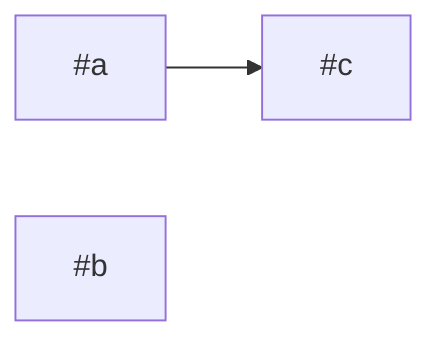

# write-ticket

Tickets are written in the language the project's tickets already use (the
templates below are in French: translate the headings if needed). Read the project's `CLAUDE.md` first: its
`## Workflow` section names the tracker (GitHub issues or Linear), extra
mandatory labels and, sometimes, its own template. A project template wins over
the default one below; the size gate and the labels apply everywhere.

## 1. Understand before writing

- Read the code the ticket will touch (search, don't guess) and existing tickets
  on the same subject (`gh issue list --search "<mots>" --state all`). Don't open
  a duplicate: comment on the existing one instead.
- Name the files likely touched. A ticket whose files you cannot name is not
  understood yet: explore more, or make it a short `model:opus` investigation
  ticket whose deliverable is the real tickets.

## 2. The size gate (the most important step)

A ticket must be deliverable by ONE agent in ONE session without its context
filling up: that is what keeps it sharp and cheap. Score the ticket:

| Signal | S | M | Too big → split |
|---|---|---|---|
| Files touched (excluding tests, i18n) | 1–3 | 4–8 | > 8 |
| Responsibilities (model, API, UI, migration, infra...) | 1 | 1–2 linked | ≥ 3 |
| "Fini quand" boxes | ≤ 3 | ≤ 6 | > 6 |
| Human time | < ½ day | ≤ 1 day | > 1 day |
| Open product/architecture decisions | 0 | 0 (decided in the ticket) | any undecided |
| Exploration needed before coding | none | one known area | "find out where/why" |

Any column in "too big" → split. Do not label anything `taille:L`.

How to split, in this order of preference:
1. **Decide first**: undecided questions become a short `model:opus` ticket
   ("Trancher X") whose "Fini quand" is the decision written in the epic.
2. **Investigate first**: "find out why" becomes its own ticket that ends with a
   measurement or a diagnosis, not a fix.
3. **Vertical slices**: each slice delivers something testable end to end
   (one screen + its route + its data), rather than "all the API, then all the UI".
4. **By layer only when a layer is a prerequisite** (a migration other tickets need).
5. **Mechanical bulk** (rename across 40 files, i18n sweep) is one `model:sonnet`
   ticket per area, files listed.

Each piece must pass the gate on its own. The pieces become sub-issues of an epic
(existing or new).

## 3. Model label

- `model:opus`: ambiguous architecture or product decision, intermittent bug,
  large scope the agent must decide itself, security-sensitive design.
- `model:sonnet`: the ticket says what to do and how to verify it; mechanical or
  well-located change; a11y/i18n/style fixes checked in the DOM.

When unsure, the question is: "does the agent have to choose between options the
ticket does not settle?" Yes → opus.

## 4. Default template (child ticket)

Title: the finding or the outcome, concrete, with numbers when there are some
(not "Améliorer X").

```markdown
## Contexte
D'où ça vient : ticket/épic d'origine, date, constat chiffré ou capture.

## Ce qu'on veut
Le résultat attendu, en une ou deux phrases. Les décisions déjà prises.

## Fichiers probablement touchés
- `chemin/fichier` : ce qui y change

## Fini quand
- [ ] critère vérifiable par quelqu'un d'autre (commande, chiffre, recette)
- [ ] vérifications du projet vertes (<commandes du CLAUDE.md>)
- [ ] recette navigateur faite (Chrome, ou Playwright en secours) — si UI
- [ ] doc à jour (ou : aucune doc concernée) — voir le skill `project-docs`

## Comment vérifier
Étapes numérotées : URL, action, résultat attendu, 0 erreur console.

## Hors périmètre
Ce que ce ticket ne résout pas, et où ça vit (#N) si c'est suivi.

## Qui valide
<personne> : visuel → la personne qui regarde ; code/données → test automatisé si possible.
```

Rules for "Fini quand": each box is checkable without asking the author; no
"c'est propre", "ça marche bien". A box that requires a human eye (annotation,
visual taste) says so, so `run-epic` knows not to wait on it at night.

Security: if the ticket touches auth, another user's data, untrusted input,
uploads, secrets or payments, add the `sécurité` label and a box
"revue `security-reviewer` sans constat HIGH/MEDIUM".

## 5. Epic template

```markdown
## Pourquoi cet épic
Le problème et le chiffre (ou le résultat utilisateur) qui dira qu'il est atteint.

## Vagues
| Vague | Tickets (modèle) | Attend | Pourquoi | Statut |
|---|---|---|---|---|
| 1 | #a (opus), #b (sonnet) | rien | pourquoi ensemble | |
| 2 | #c (opus) | #a | <raison> | |

Chemin critique : #a → #c.
Règle : deux tickets qui touchent les mêmes fichiers ne sont jamais dans la même vague.


Légende : 🟡 en cours · 🧪 livré, reste une vérification à la main · ✅ fini · ⛔ bloqué

## Hors de l'épic, exprès
## Fini quand
- [ ] critère de l'épic lui-même (pas « tous les enfants fermés »)
```

Waves come from blocked-by links AND file overlap (compare the "Fichiers
probablement touchés" lists). Keep a wave within the project's max parallel agents.

No list of the children in the body: they are sub-issues, and GitHub (or
Linear) already shows them under the epic. A table of them would only drift.

The "Vagues" section always has both the table and the Mermaid graph:
- Table: one row per wave; "Attend" lists the tickets the wave waits for;
  "Statut" is empty at creation.
- Graph: one node per child, id `t<N>`, label `"#<N>"`, an arrow per blocked-by
  link (blocker → blocked). Keep the four `classDef` lines and the legend even if unused:
  `run-epic` colours the nodes with them as the epic runs (see run-epic §2).

A **follow-up ticket** carries what a merged ticket left undone (code or tests
not written): title « <titre d'origine> : reste <quoi> », « Contexte » says
« suite de #N : livré <…>, reste <…> », its « Fini quand » holds the boxes moved
from #N, it is blocked by nothing that is closed. It is a sub-issue of the same
epic. A box that only needs a human check never makes a follow-up ticket: the
ticket stays open in « à valider ».

## 6. Create it

GitHub:
- `gh issue create --title ... --body-file <tmp> --label ...`; read back the
  number it returns, never assume it.
- Sub-issue / blocked-by links through GraphQL with node ids
  (`gh api graphql -f query='mutation{addSubIssue(input:{issueId:"<parent>",subIssueId:"<child>"}){issue{number}}}'`,
  same with `addBlockedBy`). Get node ids with `gh issue view N --json id`.

GitHub Project (when the CLAUDE.md names a board): add every created issue,
epic included, and set its fields.
- `gh project item-add <n> --owner <owner> --url <issue url> --format json` →
  the item `id` (idempotent: on an issue already there it returns the existing item,
  so it is also how to find an issue's item).
- Ids once per run: project id from `gh project view <n> --owner <owner> --format json`,
  field and option ids from `gh project field-list <n> --owner <owner> --format json`.
- `gh project item-edit --id <item> --project-id <pid> --field-id <fid> --single-select-option-id <oid>`:
  Status = the board's « à faire » option (« bloqué » if it has an open blocker),
  plus the custom fields the CLAUDE.md lists (e.g. Phase).

Linear: `save_issue` through the Linear MCP with the same body, labels from the
"Modèle IA" and "Taille" groups, `parentId` for children, `relatedTo` for
carve-outs. In Linear an epic is a parent issue (its children carry `parentId`)
or a Linear project; an `epic` label is optional, never required to find one.

## 7. Announce

Tell the user, per ticket: number, title, labels, and either
« à traiter à la suite » or « pas urgent ». If you split, show the epic table.
